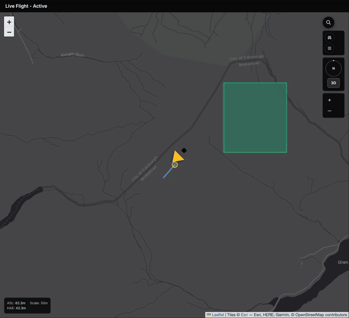
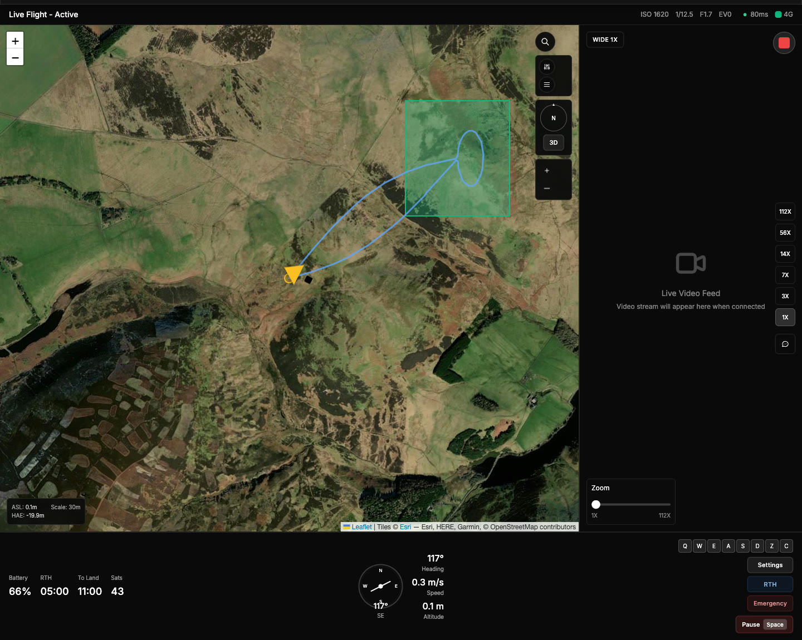
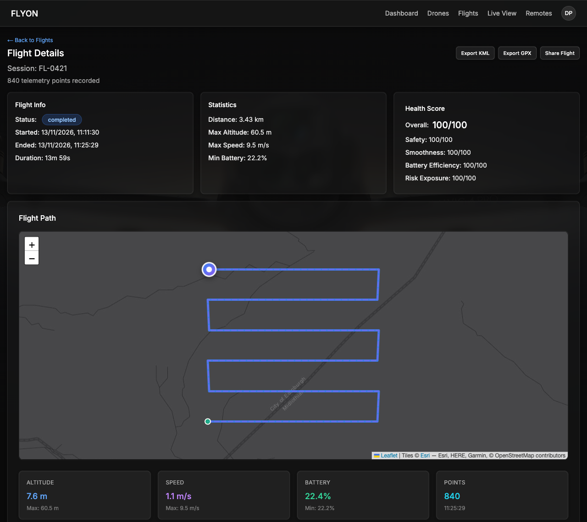
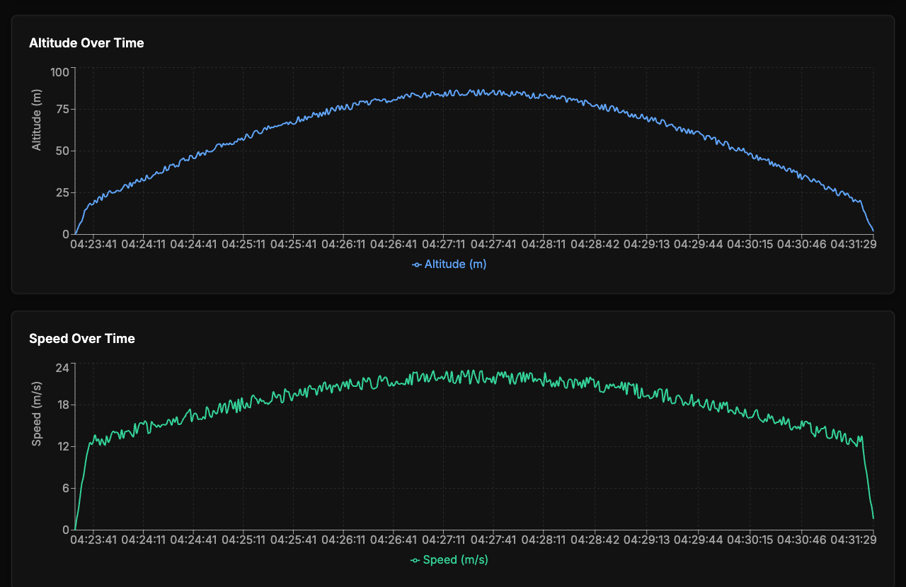
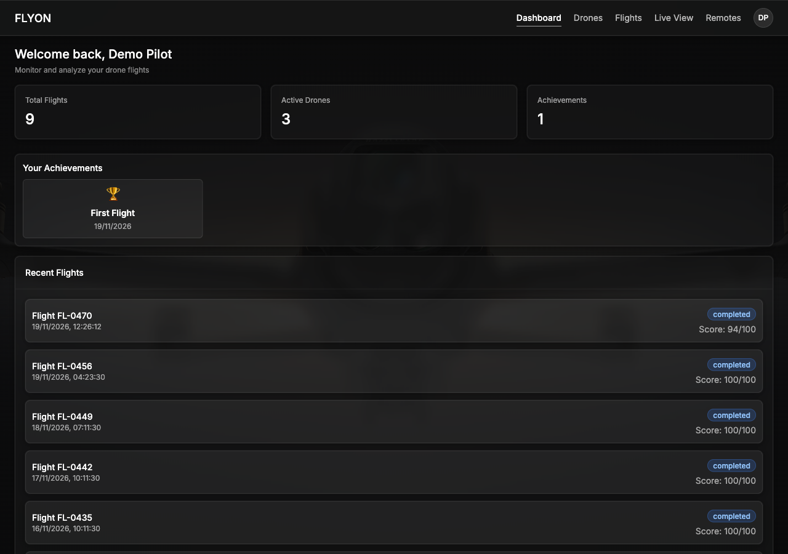
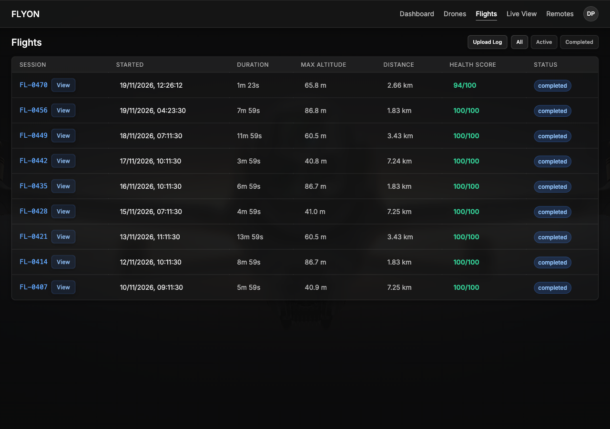
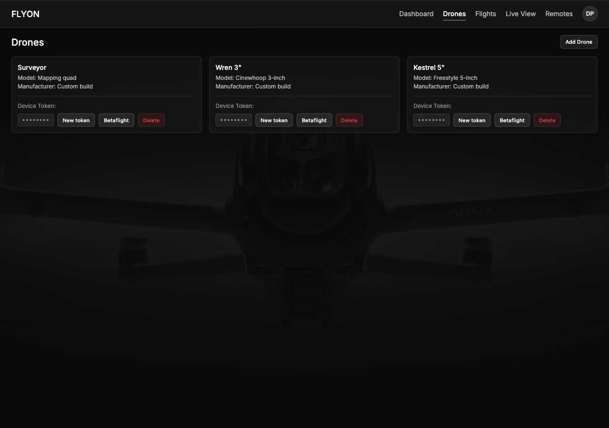
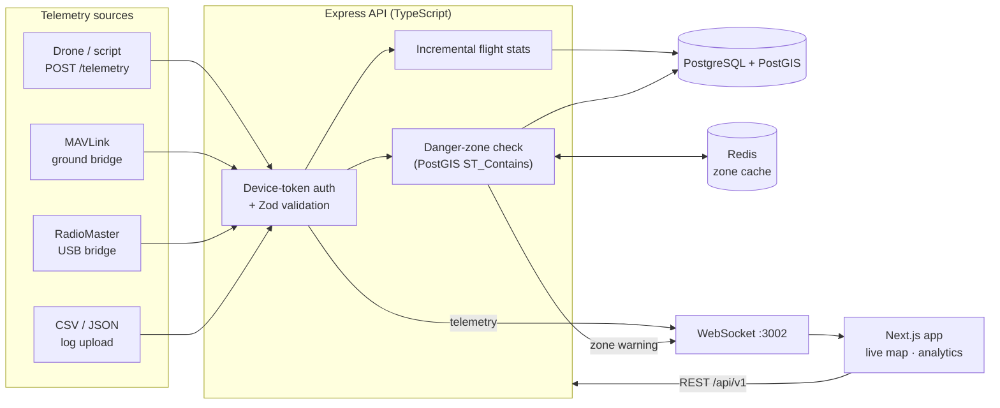

<div align="center">



# FLYON

**A web platform for drone and FPV pilots: live telemetry on a map, danger-zone warnings and post-flight analysis.**

[](https://github.com/Bogdusik/FLYON/actions/workflows/backend-ci.yml)
[](https://github.com/Bogdusik/FLYON/actions/workflows/secret-scan.yml)


[](LICENSE)

[How it works](#how-it-works) · [Screens](#screens) · [Getting started](#getting-started) · [API](#api)

</div>

FLYON takes telemetry from a drone, a ground station or a flight log, stores it in PostGIS and shows it back to the pilot: live on a map while the drone is in the air, and as statistics, charts and a health score after it lands. It is a safety assistant, not an autopilot: it warns and explains, it never flies the drone.

<sub>All screens show a fictional demo pilot and simulated flights over the Pentland Hills, sent through the same telemetry API a real drone uses.</sub>

## What it does

- **Live tracking.** Telemetry arrives over HTTP with a per-drone device token and is pushed to the browser over WebSocket. The live view follows the drone on a satellite or dark map, with heading, speed, altitude and battery.
- **Danger zones.** Zones are PostGIS polygons. Every incoming point is checked against them, and entering one sends a warning over the same WebSocket and costs the flight 20 points of its risk-exposure score.
- **Post-flight analysis.** Distance, max altitude and speed, battery drop, a 0-100 health score (safety, smoothness, battery efficiency, risk exposure), G-force and manoeuvre detection, and altitude, speed and battery charts.
- **Many ways in.** Live HTTP telemetry, CSV/JSON log upload, a MAVLink ground bridge ([`tools/ground-bridge`](tools/ground-bridge)) and a RadioMaster Pocket USB bridge ([`tools/radiomaster-bridge`](tools/radiomaster-bridge)).
- **Your data stays yours.** Export a flight to KML or GPX, export everything as JSON, share a read-only link, or delete your account and its data.

## Screens

<table>
<tr>
<td colspan="2" valign="top">
<br>
<b>Live view.</b> The path so far, danger zones, and a HUD with battery, heading, speed and altitude. Opening it mid-flight loads the points already recorded.
</td>
</tr>
<tr>
<td width="50%" valign="top">
<br>
<b>Flight details.</b> Statistics, health score and the full path, framed to fit.
</td>
<td width="50%" valign="top">
<br>
<b>Telemetry charts.</b> Altitude, speed and battery over the whole flight.
</td>
</tr>
<tr>
<td width="50%" valign="top">
<br>
<b>Dashboard.</b> Totals, achievements and recent flights with their scores.
</td>
<td width="50%" valign="top">
<br>
<b>Flight history.</b> Every session with duration, max altitude, distance and score.
</td>
</tr>
</table>

<details>
<summary><b>More</b>: drones and device tokens</summary>
<br>


Each drone gets its own device token. The list never returns tokens: a token is shown once, when the drone is added or when you issue a new one.
</details>

## How it works



- **Incremental stats.** Each live point updates the flight's running statistics with one `UPDATE` instead of re-aggregating the whole flight. A 9,000-point flight took 50.1 s instead of 152.8 s in the benchmark ([docs/performance/telemetry-ingest.md](docs/performance/telemetry-ingest.md)).
- **Bounded memory.** The live view keeps at most 10,000 points and debounces map updates (200-500 ms).
- **No hardcoded secrets.** Dev scripts read `FLYON_DEVICE_TOKEN` / `FLYON_USER_TOKEN` from the environment, and gitleaks scans every push and pull request (see [Secret scanning](#secret-scanning)).

## Tech stack

| Layer | Tech |
|---|---|
| Frontend | Next.js 14, React 18, TypeScript, Tailwind CSS, Leaflet (Esri basemaps), Recharts |
| Backend | Node.js, Express, TypeScript, Zod, `ws` |
| Data | PostgreSQL 14 with PostGIS 3.3, Redis 7 |
| Auth | JWT for users, long-lived JWT device tokens for drones and bridges |
| Bridges | Python: pymavlink ground bridge, RadioMaster Pocket serial bridge |
| Tests and CI | Jest (backend), GitHub Actions: backend lint + tests, gitleaks secret scan |

<details>
<summary><b>Project structure</b></summary>

```
FLYON/
├── backend/          # Express API + WebSocket server (TypeScript)
├── frontend/         # Next.js application
├── tools/            # MAVLink ground bridge, RadioMaster bridge
├── scripts/          # Flight simulators, start and DB helper scripts
├── docs/             # Guides, performance notes, README media
└── docker-compose.yml # PostgreSQL/PostGIS + Redis for development
```

</details>

## Getting started

**You need:** Node.js 18+, Docker Desktop and npm. The full guide is in [docs/GETTING_STARTED.md](docs/GETTING_STARTED.md).

```bash
# 1. Database and cache (PostGIS + Redis)
POSTGRES_PASSWORD=flyon_dev_password docker compose up -d

# 2. Backend
cd backend
cp env.example .env          # set JWT_SECRET; the DB password must match step 1
npm install
npm run migrate
npm run dev                  # API on :3001, WebSocket on :3002

# 3. Frontend (second terminal)
cd frontend
cp env.local.example .env.local
npm install
npm run dev                  # http://localhost:3000
```

`./scripts/start-all.sh` starts everything in one go.

**Fly a simulated flight.** Register, add a drone, copy its device token, then:

```bash
export FLYON_DEVICE_TOKEN=<token>
python3 scripts/simulate_15min_flight.py
```

Open **Live View** to watch it. See [docs/USING_DEVICE_TOKEN.md](docs/USING_DEVICE_TOKEN.md) for both tokens the scripts use.

<details>
<summary><b>Telemetry input methods</b></summary>

1. **Live HTTP:** `POST /api/v1/telemetry` with a device token, one point at a time.
2. **Log upload:** CSV or JSON through the web interface (`POST /api/v1/flights/upload-log`).
3. **Ground bridge:** MAVLink → FLYON, see [tools/ground-bridge](tools/ground-bridge).
4. **RadioMaster Pocket:** USB serial bridge for transmitter data, see [tools/radiomaster-bridge](tools/radiomaster-bridge).

</details>

## API

<details>
<summary><b>REST endpoints</b> (<code>/api/v1</code>)</summary>

| Method | Path | Description |
|---|---|---|
| `POST` | `/auth/register` | Register a new user |
| `POST` | `/auth/login` | Log in and get a JWT |
| `GET` | `/auth/me` | Current user profile |
| `GET` | `/drones` | List your drones (without tokens) |
| `POST` | `/drones` | Add a drone; the response includes its device token once |
| `POST` | `/drones/:id/regenerate-token` | Issue a new device token |
| `GET` | `/flights` | List your flights |
| `POST` | `/flights` | Create a flight session |
| `GET` | `/flights/:id/telemetry` | Telemetry points for a flight |
| `POST` | `/telemetry` | Ingest one point (device token) |
| `POST` | `/telemetry/batch` | Ingest a batch of points (device token) |
| `POST` | `/flights/upload-log` | Upload a CSV or JSON flight log |
| `GET` | `/danger-zones` | List danger zones |
| `POST` | `/analytics/flights/:id/health-score` | Calculate a flight's health score |
| `GET` | `/export/data` | Export all your data (GDPR) |
| `GET` | `/export/flights/:id/kml` | Export a flight to KML |
| `GET` | `/export/flights/:id/gpx` | Export a flight to GPX |

</details>

<details>
<summary><b>WebSocket events</b></summary>

Connect to `ws://localhost:3002?token=<JWT>`.

| Event | Payload |
|---|---|
| `subscribe` (client → server) | `{ type: 'subscribe', flight_id }` |
| `telemetry` | `{ type: 'telemetry', flight_id, data }` |
| `warning` | `{ type: 'warning', data }`: danger-zone entry |
| `flight_update` | `{ type: 'flight_update', flight_id, data }` |

</details>

## Secret scanning

Tokens are never hardcoded. The dev scripts read `FLYON_DEVICE_TOKEN` / `FLYON_USER_TOKEN` from the environment (see [docs/USING_DEVICE_TOKEN.md](docs/USING_DEVICE_TOKEN.md)).

- **CI:** `.github/workflows/secret-scan.yml` runs [gitleaks](https://github.com/gitleaks/gitleaks) on every push and pull request, scanning only the commits they introduce.
- **Config:** `.gitleaks.toml` extends the default rules and allowlists doc placeholders such as `YOUR_TOKEN`.
- **Pre-commit (optional):** blocks a commit when staged changes contain a secret.

  ```bash
  brew install pre-commit   # or: pipx install pre-commit
  pre-commit install        # once per clone
  pre-commit run gitleaks   # scan staged changes manually
  ```

- **Manual scan of the working tree:** `gitleaks dir .`

## License

[MIT](LICENSE)
